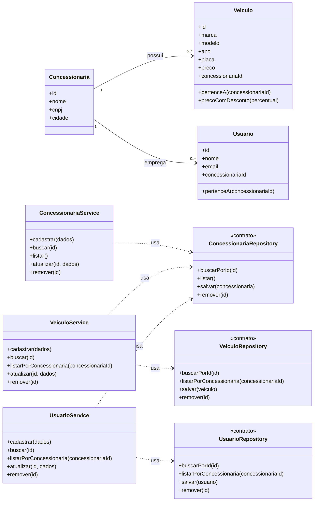

# Modelagem — Projeto 1

**Aluno(a):** Seu Nome Completo
**Domínio:** Controle de uma concessionária de veículos

## 1. O domínio

Uma concessionária mantém um estoque de veículos e uma equipe de usuários cadastrados.
Cada veículo pertence a uma concessionária, e cada usuário está vinculado a uma
concessionária. Uma concessionária, por sua vez, tem vários veículos e vários usuários.

## 2. Entidades

| Entidade | Atributos | Relacionamentos |
|---|---|---|
| Concessionaria | id, nome, cnpj, cidade | tem vários veículos e vários usuários |
| Veiculo | id, marca, modelo, ano, placa, preco, concessionariaId | pertence a uma concessionária |
| Usuario | id, nome, email, concessionariaId | está vinculado a uma concessionária |

## 3. Diagrama de classes

## 4. Responsabilidades

| Classe | Papel | Único motivo para mudar |
|---|---|---|
| Concessionaria, Veiculo, Usuario | entidades | as regras do próprio objeto (ex.: cálculo do preço com desconto) |
| ConcessionariaService | regra de negócio | o processo de gerenciar concessionárias |
| VeiculoService | regra de negócio | o processo de gerenciar veículos (ex.: exigir que a concessionária exista) |
| UsuarioService | regra de negócio | o processo de gerenciar usuários (ex.: exigir que a concessionária exista) |
| ConcessionariaRepository, VeiculoRepository, UsuarioRepository | acesso aos dados | a forma de guardar (memória na S3, SQLite na S5) |

## 5. Onde apliquei SRP e DIP

- **SRP:** nenhuma entidade salva a si mesma. Guardar é papel dos repositories; as
  regras de cada processo ficam nos services, e as regras do próprio objeto ficam na entidade.
- **DIP:** cada service depende dos contratos dos repositories, recebidos pelo construtor.
  Eles não sabem se os dados estão em memória ou em um banco. O `VeiculoService` e o
  `UsuarioService` usam o `ConcessionariaRepository` para validar que a concessionária
  informada existe antes de salvar.

## 6. Fora do escopo (YAGNI)

Login, vendas, financiamento, test-drive e relatórios não entram no Projeto 1.
